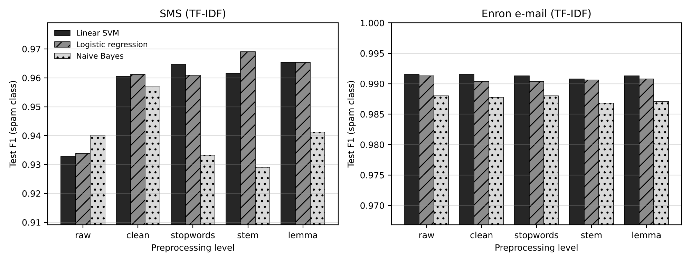
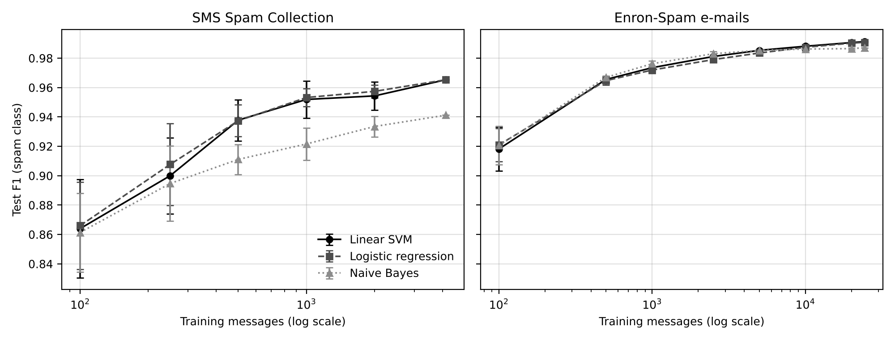
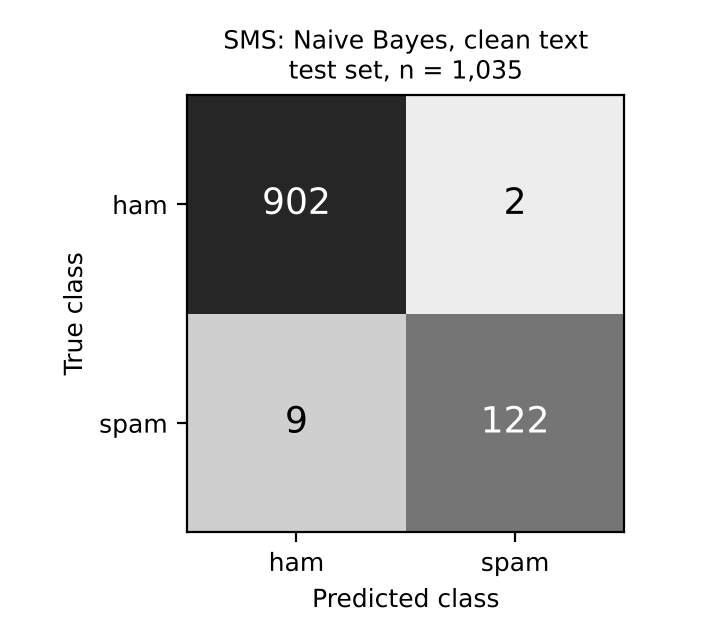
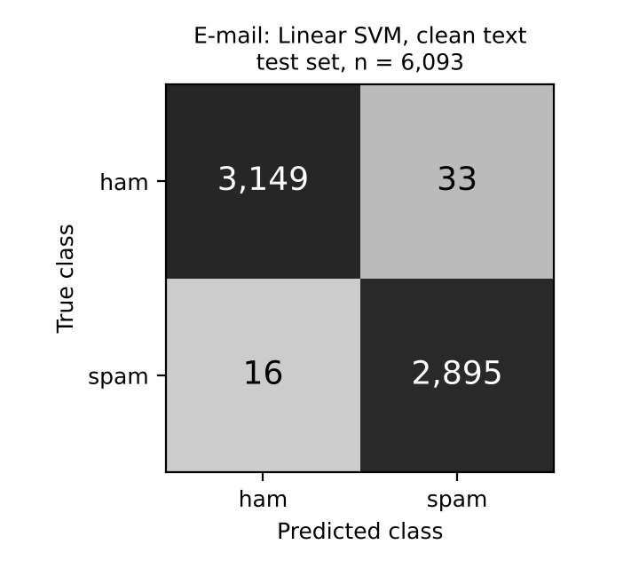

# Spam Detection with NLP (DLBAIPNLP01 – Task 2)

An NLP system that classifies messages as **spam** or **ham** (legitimate). It
collects two public labelled corpora, preprocesses the text (normalisation,
stop-word removal, stemming / lemmatising, BoW / TF-IDF encoding), trains
supervised models (Naive Bayes, linear SVM, logistic regression and a small
neural network), evaluates them on held-out test data from small to large
training sets, and ships a command-line tool that classifies new messages.

**Final test-set performance (held-out 20 %, never used for training or model selection)**

| Channel | Model | Accuracy | Precision | Recall | F1 | ROC-AUC | Ham wrongly flagged |
|---|---|---|---|---|---|---|---|
| SMS (1,035 msgs) | Naive Bayes + TF-IDF, cleaned text | **98.94 %** | 98.39 % | 93.13 % | 95.69 % | 0.996 | 2 of 904 (0.22 %) |
| E-mail (6,093 msgs) | Linear SVM + TF-IDF, cleaned text | **99.20 %** | 98.87 % | 99.45 % | 99.16 % | 0.999 | 33 of 3,182 (1.04 %) |

---

## Quick start

```bash
python -m venv .venv && source .venv/bin/activate      # Windows: .venv\Scripts\activate
pip install -r requirements.txt

python src/train.py          # downloads data, selects + trains both models (~5-10 min)
python src/predict.py "URGENT! Your mobile has won £2000. Call 09061743810 to claim"
python -m pytest -q          # 23 tests
python src/experiments.py    # reproduces every table and figure below (~30-40 min)

# full reproduction as in the report appendix (executes the notebook, ~40 min)
python src/create_notebook.py && python src/execute_notebook.py
python src/build_report.py --repo <this repository URL>   # report + appendix PDFs -> output/
```

Example output:

```
SPAM [sms  ] score=+12.934  URGENT! Your mobile has won £2000. Call 09061743810 to claim
HAM  [sms  ] score= -4.189  hey, running 10 min late, order me a coffee?
HAM  [sms  ] score= -3.156  Are you free for a call about the budget tomorrow at 3?
```

`predict.py` also reads a file (`--file msgs.txt`, one message per line) or stdin.
`--channel auto` (default) sends short texts to the SMS model and long or
multi-line texts to the e-mail model; `--channel sms|email` forces one.

## Repository layout

```
src/data.py          download + load the two corpora, remove duplicates
src/preprocess.py    normalisation, stop words, Porter stemming, WordNet lemmatising
src/models.py        vectorisers, classifiers, metrics
src/experiments.py   experiments E0-E4 -> results/*.csv, figures/*.png
src/train.py         cross-validated model selection + final models -> models/
src/predict.py       classify new messages (CLI + classify() function)
src/create_notebook.py / execute_notebook.py   build and run the experiment notebook
src/build_report.py  project report PDF + executed-notebook appendix -> output/
notebooks/           Spam_Detection_Experiments.ipynb (executed, with all outputs)
output/              Spam_Detection_Project_Report.pdf, notebook PDF, combined submission PDF
tests/               unit, integration and end-to-end tests
results/             metric tables (CSV/JSON) for every experiment
figures/             learning curves, preprocessing ablation, confusion matrices
models/              trained pipelines (raw text in, label out)
```

## 1. Data collection

| Corpus | Type | Raw | After de-duplication | Spam share | Median length |
|---|---|---|---|---|---|
| SMS Spam Collection (UCI; Almeida & Hidalgo, 2011) | SMS | 5,574 | 5,171 | 12.6 % | 12 words |
| Enron-Spam (Metsis et al., 2006) | E-mail (subject + body) | 33,665 | 30,462 | 47.8 % | 154 words |

The SMS corpus is the *small* scenario and Enron-Spam the *large* one (≈ 6×
more messages, > 100× more words). Exact duplicates were removed **before**
splitting; otherwise identical messages land in both train and test and inflate
scores. Each corpus has one fixed, stratified 80/20 train/test split (seed 42).

> The UCI *Spambase* dataset mentioned in the brief contains only 57
> pre-computed numeric features, not text, so it cannot be used to evaluate
> stop-word removal, stemming or text encoding. Raw-text corpora were chosen
> for that reason.

## 2. Preprocessing

Five cumulative levels are compared (`src/preprocess.py`):

| Level | What it does |
|---|---|
| `raw` | lower-case only (baseline) |
| `clean` | URLs, e-mail addresses, phone numbers, currency symbols and numbers replaced by placeholder tokens (`tok_url`, `tok_phone`, `tok_money`, …); punctuation removed |
| `stopwords` | `clean` + NLTK English stop words removed |
| `stem` | `stopwords` + Porter stemming |
| `lemma` | `stopwords` + WordNet lemmatising (noun, then verb) |

Text is then encoded as **Bag-of-Words counts** or **TF-IDF** (sublinear TF),
both over unigrams + bigrams with `min_df=2`, up to 50,000 features.

## 3. Models

All are scikit-learn pipelines, so a saved model accepts raw text.

* **Multinomial Naive Bayes** (α = 0.1)
* **Linear SVM** (C = 1, balanced class weights)
* **Logistic regression** (C = 10, balanced class weights)
* **MLP neural network** (one hidden layer of 64 ReLU units, early stopping) – deep-learning baseline

## 4. Evaluation

Metrics treat **spam as the positive class**: accuracy, precision, recall, F1,
ROC-AUC, and the **false-positive rate** (share of legitimate messages wrongly
flagged), which is the most costly error for users.

### E1 – Which preprocessing helps? (test F1, TF-IDF)

| Corpus | Level | Naive Bayes | Linear SVM | Log. reg. |
|---|---|---|---|---|
| SMS | raw | 0.9402 | 0.9328 | 0.9339 |
| SMS | clean | **0.9569** | 0.9606 | 0.9612 |
| SMS | stopwords | 0.9333 | 0.9647 | 0.9609 |
| SMS | stem | 0.9291 | 0.9615 | **0.9690** |
| SMS | lemma | 0.9412 | **0.9653** | 0.9653 |
| E-mail | raw | 0.9880 | **0.9916** | 0.9913 |
| E-mail | clean | 0.9878 | **0.9916** | 0.9904 |
| E-mail | stopwords | 0.9880 | 0.9913 | 0.9904 |
| E-mail | stem | 0.9868 | 0.9908 | 0.9906 |
| E-mail | lemma | 0.9871 | 0.9913 | 0.9908 |



* **Normalisation matters most on SMS**: replacing numbers, phone numbers and
  currency with tokens raises F1 by ≈ 3 points for the linear models. SMS spam
  is dominated by "call 0906…", "£1000", "txt 87121" patterns that are all
  different strings until normalised.
* **Stop-word removal and stemming/lemmatising** add a little for the linear
  models on SMS but **hurt Naive Bayes** (−2.4 points): short texts lose
  context words, and NB's independence assumption makes it more sensitive.
* **On e-mail, preprocessing barely matters** (all within 0.1 point): with
  long documents there is enough signal that the classifier learns around
  noise.
* **TF-IDF beats BoW counts** on average (SMS 0.952 vs 0.950; e-mail 0.990 vs
  0.983). Full BoW results: `results/e1_preprocessing.csv`.

### E2 – Small to large training sets (learning curves)

Each model is trained on stratified subsets of the training split and always
scored on the same full test set; points below the full size are the mean of 5
random subsets.

| Train messages | SMS – SVM | SMS – NB | E-mail – SVM | E-mail – NB |
|---|---|---|---|---|
| 100 | 0.864 | 0.861 | 0.918 | 0.921 |
| 500 | 0.938 | 0.911 | 0.966 | 0.967 |
| 1,000 | 0.952 | 0.922 | 0.974 | 0.976 |
| 2,000 / 2,500 | 0.954 | 0.934 | 0.981 | 0.983 |
| 4,136 (all SMS) / 5,000 | 0.965 | 0.941 | 0.985 | 0.985 |
| 10,000 | – | – | 0.988 | 0.986 |
| 24,369 (all e-mail) | – | – | **0.991** | 0.987 |



* Performance rises steeply up to ≈ 1,000 messages and then flattens; the
  variance between random subsets shrinks from ±3 points to < 1 point.
* Naive Bayes is competitive with very little data but plateaus first; the
  discriminative models (SVM, logistic regression) keep improving with more
  data – the classic generative vs. discriminative trade-off.
* The SMS curve has not fully flattened, so more labelled SMS data would still
  help; the e-mail curve has essentially converged.

### E3 – Model comparison (lemma + TF-IDF)

| Corpus | Model | 5-fold CV F1 | Test acc. | Precision | Recall | F1 | ROC-AUC | Train time |
|---|---|---|---|---|---|---|---|---|
| SMS | Naive Bayes | 0.940 ± 0.018 | 0.9855 | 0.9677 | 0.9160 | 0.9412 | 0.9937 | 0.1 s |
| SMS | Linear SVM | 0.945 ± 0.017 | 0.9913 | 0.9766 | 0.9542 | 0.9653 | 0.9978 | 0.2 s |
| SMS | Logistic reg. | 0.946 ± 0.017 | 0.9913 | 0.9766 | 0.9542 | 0.9653 | 0.9975 | 0.1 s |
| SMS | MLP | 0.922 ± 0.025 | 0.9874 | 0.9917 | 0.9084 | 0.9482 | 0.9944 | 4.7 s |
| E-mail | Naive Bayes | 0.987 ± 0.001 | 0.9877 | 0.9870 | 0.9873 | 0.9871 | 0.9989 | 12 s |
| E-mail | Linear SVM | 0.990 ± 0.001 | 0.9916 | 0.9877 | 0.9948 | 0.9913 | 0.9992 | 13 s |
| E-mail | Logistic reg. | 0.989 ± 0.002 | 0.9911 | 0.9870 | 0.9945 | 0.9908 | 0.9992 | 14 s |
| E-mail | MLP | 0.989 ± 0.001 | 0.9902 | 0.9884 | 0.9911 | 0.9897 | 0.9992 | 98 s |

Cross-validation and test scores agree closely, so the models are not
over-fitted to one split. The neural network does **not** beat the linear
models: with sparse TF-IDF features the classes are already almost linearly
separable, and the MLP costs 7–26× more training time. It also overfits the
small SMS set (lowest CV F1, highest variance).

### E4 – Generalisation across message types

| Trained on | Tested on | Accuracy | Precision | Recall | F1 | Ham flagged |
|---|---|---|---|---|---|---|
| SMS | SMS | 0.9913 | 0.9766 | 0.9542 | 0.9653 | 0.33 % |
| SMS | E-mail | 0.5444 | 0.5277 | 0.4414 | 0.4807 | 36.1 % |
| E-mail | SMS | 0.3140 | 0.1448 | 0.9008 | 0.2495 | 77.1 % |
| E-mail | E-mail | 0.9916 | 0.9877 | 0.9948 | 0.9913 | 1.13 % |
| SMS + e-mail | SMS | 0.9585 | 0.7750 | 0.9466 | 0.8522 | 3.98 % |
| SMS + e-mail | E-mail | 0.9839 | 0.9920 | 0.9742 | 0.9830 | 0.72 % |

A model only generalises to the kind of text it was trained on. The e-mail
model labels 77 % of genuine SMS as spam (casual texts look nothing like
corporate Enron mail), and the SMS model is near chance on e-mail. Training on
both corpora together is far better, but still loses 11 F1 points on SMS
versus the SMS-only model, because the 6× larger e-mail corpus (half spam)
dominates. Weighting the corpora equally narrowed that gap only partly
(SMS F1 0.87–0.90). **This result drove the final design: one specialised
model per channel plus a router.**

## 5. Final system

`src/train.py` selects, for each channel separately, the best of
{clean, stopwords, stem, lemma} × {Naive Bayes, linear SVM, logistic
regression} by stratified cross-validation **on the training split only**
(5 folds for SMS, 3 for e-mail), refits the winner on the full training split,
and evaluates it once on the untouched test split.

| | SMS model | E-mail model |
|---|---|---|
| Selected by CV | Naive Bayes + `clean` (CV F1 0.960) | Linear SVM + `clean` (CV F1 0.991) |
| Test accuracy | 98.94 % | 99.20 % |
| Test F1 (spam) | 0.957 | 0.992 |
| False-positive rate | 0.22 % | 1.04 % |
| Training time | 0.3 s | 23 s |
| Prediction time | 0.06 ms / message | 0.6 ms / message |

<p>


</p>

For SMS, CV picked Naive Bayes on lightly cleaned text: it gives the lowest
false-positive rate (2 legitimate messages flagged out of 904) at the cost of
missing a few more spam messages (recall 93 %). For a spam filter that is the
preferable trade-off – a missed spam is an annoyance, a lost legitimate message
is a real cost.

## 6. Testing

`python -m pytest -q` runs 23 tests:

* **unit** – each preprocessing step, placeholder tokens, invalid input, metric arithmetic;
* **model** – every algorithm trains and predicts on a toy corpus;
* **data** – both corpora load, labels are binary, no duplicates, expected class balance;
* **end-to-end** – the SMS pipeline must reach > 97 % accuracy, F1 > 0.88 and < 2 % false positives on a fresh split;
* **deployment** – the saved models classify new SMS and e-mail examples correctly, routing works, the CLI runs.

## 7. Limitations and next steps

* Enron-Spam is 2000s corporate e-mail; modern spam (phishing links, image
  spam, multilingual text) will differ – retraining on recent data is needed.
* The channel router is a simple length / line-break rule; a learned
  channel classifier, or a domain-adaptation approach, could replace it.
* Transformer models (e.g. fine-tuned DistilBERT) could recover the last
  recall points on SMS, but at much higher compute cost for little gain here.
* Thresholds are left at the classifier default; a deployment could tune the
  decision threshold to a target false-positive rate.

## References

Almeida, T. A., & Hidalgo, J. M. G. (2011). SMS Spam Collection [Data set]. UCI Machine Learning Repository. https://doi.org/10.24432/C5CC84

Jurafsky, D., & Martin, J. H. (2013). *Speech and language processing* (2nd ed.). Pearson Prentice Hall.

Metsis, V., Androutsopoulos, I., & Paliouras, G. (2006). Spam filtering with Naive Bayes – which Naive Bayes? *Third Conference on Email and Anti-Spam (CEAS)*.

Pedregosa, F., et al. (2011). Scikit-learn: Machine learning in Python. *Journal of Machine Learning Research, 12*, 2825–2830.
